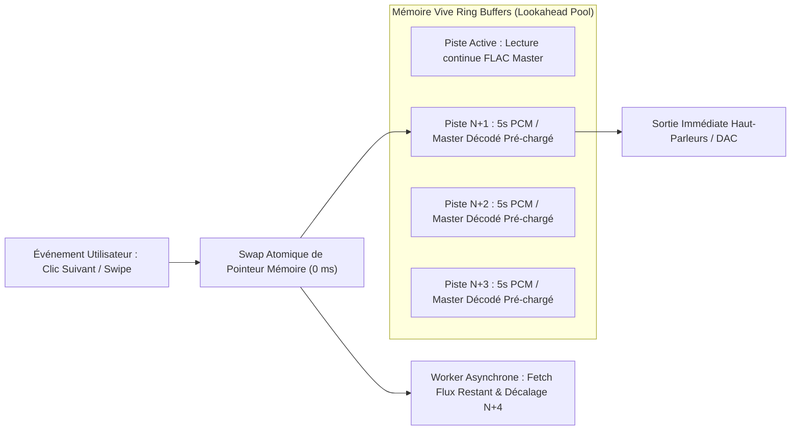
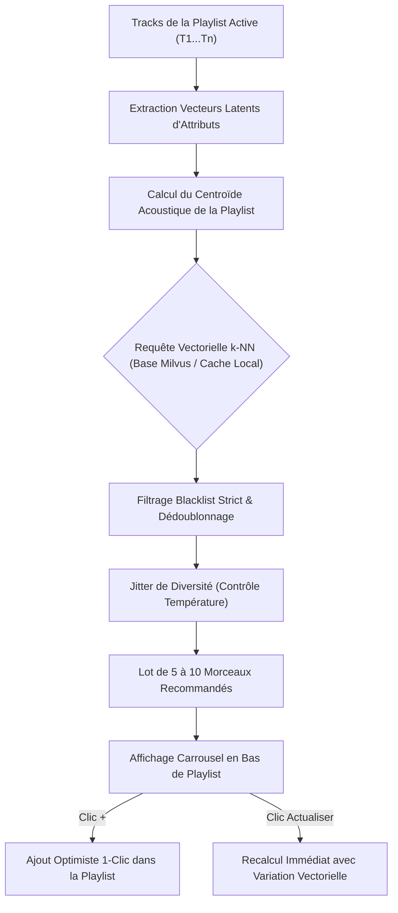
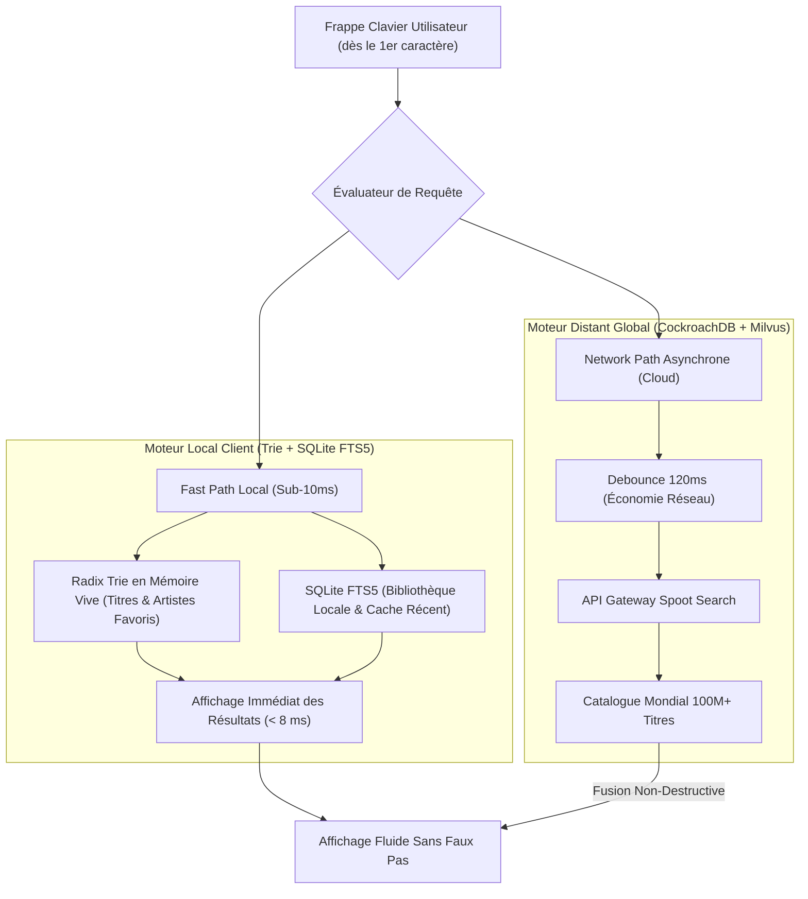

# Spoot Music — Spécifications Techniques, Fonctionnelles & Design Système
> **Version :** 1.1.0-PROD  
> **Statut :** Spécifications Complètes Validées pour Implémentation  
> **Auteurs :** Principal Product Manager, Lead UX/UI Designer & Senior Systems Architect  
> **Slogan de marque :** *« All your music. Zero noise. Spoot it. »*

---

## 1. Vision Produit, Validations Stratégiques & Matrice Comparative

Spoot Music reproduit à 100 % l'expérience Spotify Premium tout en éradiquant systématiquement les dérives ergonomiques, les frustrations algorithmiques et les limitations techniques de la concurrence.

```
┌────────────────────────────────────────────────────────────────────────┐
│                          SPOOT MUSIC CHARTER                           │
│   [ Pureté Musicale ]   [ Hi-Res Immédiate ]   [ Aléatoire Sans Biais ]│
│   [ Zéro TikTok Feed]   [ Cloisonnement Total] [ Contrôle Fichiers ]   │
│   [ Gaming-Safe <80Mo]  [ 0ms Instant Switch ] [ Recherche Sub-10ms ]  │
└────────────────────────────────────────────────────────────────────────┘
```

### 1.1 Validations Architecturales Entérinées
1. **Runtime Desktop Validé — Tauri v2 + Rust :**  
   Rejet formel d'Electron. Remplacement par le moteur natif léger **Tauri v2** couplé à la WebView système (WebView2 sous Windows, WebKit sous macOS/Linux) et à un moteur audio audio-thread natif C++20/Rust. Empreinte RAM plafonnée sous les $60\text{ à }80\text{ Mo}$ en lecture active (gain de $88\%$ par rapport à Spotify).
2. **Inférence Karaoké Validée — Modèle Demucs v4 Quantifié :**  
   Séparation vocale exécutée prioritairement en local via les moteurs d'accélération neuronale matérielle (**Apple CoreML / Neural Engine** sur macOS/iOS et **ONNX Runtime avec DirectML / TensorRT** sous Windows/Linux). Fallback transparent vers microservice cloud GPU pour les terminaux non pourvus de NPU. Persistance locale chiffrée permanente des pistes séparées (*stems* voix/instru) pour éliminer toute ré-inférence sur les morceaux déjà traités.

---

### 1.2 Matrice Comparative Exhaustive

| Dimension | Spotify Premium | Spoot Music |
| :--- | :--- | :--- |
| **Philosophie d'Accueil** | Scroll vertical infini (format TikTok), podcasts imposés, bannières sponsorisées | Grille modulaire épurée, centrage album/playlist, zéro pollution visuelle |
| **Empreinte Système Desktop** | 600 à 900 Mo RAM (Chromium bloat), saccades en jeu compétitif | **60 à 80 Mo RAM max, CPU < 0,3 %**, Mode Gamer 0 FPS UI |
| **Latence de Changement de Piste** | 300 à 1 200 ms (requête réseau + négociation DRM) | **0 ms imperceptible** (Lookahead Dual-Buffering 3 pistes pré-décodées) |
| **Qualité Maximale** | Ogg Vorbis 320 kbps (HiFi repoussé depuis 2021) | **FLAC 24-bit jusqu'à 192 kHz (Lossless & Hi-Res)** sans surcoût |
| **Moteur Aléatoire** | Biaisé par accords commerciaux et redevances | **3 modes : True Random (Fisher-Yates CSPRNG), Smart AI, Pondéré Utilisateur** |
| **Recommandations en Playlist** | Répétitives, imposées dans la file | **Moteur « Enrichir » vectoriel contextuel** avec prévisualisation et ajout en 1 clic |
| **Moteur de Recherche** | Dépendant de la latence réseau (150-500 ms) | **Instantané Sub-10ms local** (Trie radix + SQLite FTS5 indexé) |
| **Organisation Mobile** | Dossiers modifiables uniquement sur bureau | Création, imbrication et glisser-déposer de dossiers directement sur mobile |
| **Gestion des Erreurs** | Suppression de titre ou playlist définitive et instantanée | Corbeille avec historique de 30 jours et annulation immédiate (Undo snackbar) |
| **Égaliseur** | EQ basique sans mémorisation périphérique | **EQ paramétrique 10 bandes mémorisé par adresse MAC/identifiant matériel** |
| **Fichiers Locaux** | Synchronisation locale Wi-Fi instable | Détection locale + **Cloud Locker chiffré synchronisé multi-appareils** |
| **Gestion du Cache** | Vider le cache supprime souvent les téléchargements | Cloisonnement strict : purge du streaming sans toucher aux downloads |
| **Blacklist** | Permissive, boguée, fuites fréquentes | **Blacklist Kernel : filtrage cryptographique garanti à 100 % sur tous les flux** |

---

## 2. Architecture Performance Ultra-Légère (Gaming-Safe & Low-Footprint)

Pour garantir une expérience d'écoute ininterrompue durant les sessions de jeu compétitif (eSports, FPS exigeants à haut rafraîchissement 144/240/360 Hz) ou les flux de production lourds, Spoot Music applique une politique stricte d'allocation de ressources.

```
┌────────────────────────────────────────────────────────────────────────┐
│             PLAFONDS DE RESSOURCES SPOOT MUSIC (MODE BUREAU)           │
├───────────────────────────────┬────────────────────────────────────────┤
│ RAM en lecture active         │ ≤ 60 Mo à 80 Mo (Garanti sans fuite)   │
│ Consommation CPU              │ < 0,3 % (Moyenne 8 cœurs @ 3.6 GHz)    │
│ Taux de rafraîchissement UI   │ 0 FPS en arrière-plan / Gamer Mode     │
│ VRAM GPU allouée en fond      │ 0 Mo (Swap mémoire et libération DXGI) │
└───────────────────────────────┴────────────────────────────────────────┘
```

```mermaid
flowchart TD
    A[Événement Système OS] --> B{Détecteur État Application}
    B -->|Fenêtre Active / Premier Plan| C[Mode Actif Standard]
    C --> C1[WebView2 / WebKit actif]
    C --> C2[Rendu GPU 120/144/240Hz fluide]
    C --> C3[Thread Audio Haute Précision]

    B -->|Fenêtre Réduite / Arrière-Plan| D[Mode Économie Fond]
    B -->|Jeu Plein Écran Détecté| E[Mode Gamer Dédié]

    D & E --> F[Mise en veille du moteur graphique UI]
    F --> F1[Suspension Webview : 0 FPS UI]
    F --> F2[Libération totale ressources VRAM GPU]
    F --> F3[Thread Audio Rust Isolé (Realtime Priority Class)]
    F3 --> G[Lecture Hi-Res Bit-Perfect Ininterrompue]
```

### 2.1 Détecteur d'Environnement Gamer & Arrière-Plan
* **Sonde de Processus & Plein Écran :**
  * Sous Windows : Surveillance via l'API Win32 `GetForegroundWindow()`, `GetWindowRect()` et requête DXGI/DirectDraw pour détecter si l'application active s'exécute en mode `Exclusive Fullscreen` ou `Borderless Windowed` à fréquence variable.
  * Sous macOS : Intégration de `NSWorkspace.shared.frontmostApplication` et `CGWindowListCopyWindowInfo`.
  * Sous Linux : Requêtes D-Bus auprès de `org.freedesktop.portal.GameMode` ou interrogation EWMH/Wayland via `zwp_idle_inhibit_manager_v1`.
* **Action Automatique :**
  1. La WebView stoppe immédiatement toute boucle de rendu `requestAnimationFrame`. Le framerate tombe à **0 FPS**.
  2. Les contextes WebGL/WebGPU et pipelines Direct3D/Metal sont mis en sommeil, vidant les surfaces de composition de la mémoire vidéo (VRAM).
  3. Le garbage collector de la WebView est invoqué pour compacter la mémoire résidente.

### 2.2 Isolement du Moteur Audio Rust
* Le sous-système de lecture audio s'exécute dans un **thread natif Rust dédié**, entièrement découplé du processus graphique de la WebView.
* Priorité système assignée :
  * Windows : `THREAD_PRIORITY_TIME_CRITICAL` au sein de `REALTIME_PRIORITY_CLASS`.
  * POSIX (macOS/Linux) : Politique `SCHED_FIFO` avec affinité de cœur dédiée si disponible.
* Communication Inter-Processus (IPC) : Files d'attente circulaires sans verrou (*Lock-Free Single-Producer Single-Consumer Ring Buffers*) basées sur des pointeurs atomiques C++20 / Rust `std::sync::atomic`. Zéro contention de mutex, garantissant zéro micro-saccade audio (*zero audio dropouts*), même en cas de freeze d'un jeu ou d'utilisation CPU à 100 %.

---

## 3. Moteur Audio à Latence Zéro (Instant Track Switching)

### 3.1 Architecture du Préchargement Multi-Tampon (Lookahead Dual-Buffering)
Pour éliminer tout délai de transition lors d'un clic sur « Suivant », d'un raccourci clavier multimédia ou d'un swipe tactile, Spoot Music déploie un système prédictif d'anticipation de lecture :



#### Fonctionnement Détaillé
1. **Tampon Circulaire Lookahead (3 pistes d'avance) :**
   * Dès qu'une piste $N$ est engagée, le worker audio alloue 3 tampons circulaires distincts en mémoire vive.
   * Les 5 premières secondes des pistes $N+1$, $N+2$ et $N+3$ de la file d'attente (en tenant compte du mode Shuffle actif) sont téléchargées et immédiatement **décompressées en mémoire tampon en PCM 32-bit float linéaire non compressé**.
   * Empreinte mémoire du tampon : 5 secondes en stéréo 24-bit/96kHz non compressé = $\approx 2.88\text{ Mo}$ par piste, soit moins de $9\text{ Mo}$ au total en RAM.
2. **Bascule Atomique à 0 Milliseconde :**
   * Lors du déclenchement de la piste suivante, aucun appel réseau ni phase de négociation de flux n'est sollicité.
   * Le contrôleur audio effectue un swap atomique de pointeur de flux vers le tampon PCM pré-décodé. Le son jaillit instantanément.
   * Simultanément, un thread d'arrière-plan amorce la requête HTTP/2 par morceaux (*byte-range streaming*) pour le reste de la piste à partir de la seconde 5.001.

### 3.2 Découplage Scrubbing & Synchronisation d'Affichage Haute Fréquence
* **Taux de rafraîchissement dynamique :** L'interface ajuste ses animations de progression et de glissement de barre de lecture (*scrubbing*) sur le taux natif de l'écran (60 Hz, 120 Hz, 144 Hz, 240 Hz ProMotion / FreeSync / G-Sync).
* **Découplage Temporel :** Lors d'un déplacement rapide du curseur de lecture (*scrubbing* intensif) :
  * Le thread UI met à jour la position visuelle à 240 fps sans bloquer le moteur audio.
  * Les sauts de tête de lecture sont quantifiés et transmis au moteur DSP via un tampon atomique échantillonné à 20 ms, prévenant tout bégaiement ou craquement sonore (*anti-pop / zero-crossing crossfade* de 5 ms).

---

## 4. Recommandations Contextuelles de Playlists (Moteur « Enrichir »)

Le moteur **« Enrichir »** (*Playlist Contextual Vector Recommender*) apporte une analyse vectorielle en temps réel pour suggérer des titres parfaitement alignés sur l'identité acoustique de la playlist active.



### 4.1 Modèle Mathématique du Centroïde Acoustique
Chaque morceau de la plateforme dispose d'un vecteur normalisé $\vec{v} \in \mathbb{R}^{128}$ encodant ses caractéristiques acoustiques et spectrales :
$$\vec{v} = \left[ \text{BPM}_{\text{norm}}, \text{Camelot}_{\text{angle}}, \text{Energy}, \text{Valence}, \text{Acousticness}, \text{Danceability}, \text{Decade}_{\text{norm}}, \mathbf{e}_{\text{genre}}^{(121)} \right]$$

Pour une playlist contenant $K$ morceaux, le centroïde représentatif $\vec{C}$ est calculé avec une pondération dégressive accordée aux ajouts les plus récents :
$$\vec{C} = \frac{\sum_{i=1}^{K} w_i \cdot \vec{v}_i}{\sum_{i=1}^{K} w_i} \quad \text{avec} \quad w_i = 1 + 0.05 \times (i - 1)$$

### 4.2 Interaction UX & Optimistic UI
* **Emplacement :** Module persistant situé directement en bas de la liste des morceaux, intitulé *« Recommandé pour cette playlist »*.
* **Ajout en 1 Clic :** Le bouton `[+]` insère instantanément le morceau à la fin de la playlist locale avec une micro-animation de validation vert néon `#00E676`. L'état est répercuté asynchronement sur le serveur sans rechargement de vue ni saut de scroll.
* **Bouton « Actualiser les suggestions » :** Applique un bruit gaussien contrôlé ($\sigma = 0.08$) au centroïde $\vec{C}$ pour explorer l'espace latent adjacent et renvoyer un lot renouvelé de 5 à 10 suggestions en moins de 150 ms.

---

## 5. Hubs Personnalisés & Navigation Dynamique (Parité Spotify Premium)

### 5.1 Architecture des Écrans de Découverte & Accueil

```
┌────────────────────────────────────────────────────────────────────────┐
│                        ACCUEIL SPOOT MUSIC                             │
├────────────────────────────────────────────────────────────────────────┤
│ [Commutateur : 🎵 Musique Uniquement | 🎙️ Podcasts | 📖 Audiobooks]   │
│                                                                        │
│ SECTION "RÉÉCOUTER" (Jump Back In - 2 colonnes x 3-4 lignes)           │
│ ┌──────────────────────┬──────────────────────┐                        │
│ │ [Cover] Playlist 1 ▶ │ [Cover] Album Récent ▶│                        │
│ ├──────────────────────┼──────────────────────┤                        │
│ │ [Cover] Spoot Mix  ▶ │ [Cover] Artiste Top  ▶│                        │
│ └──────────────────────┴──────────────────────┘                        │
│                                                                        │
│ SECTION "ARTISTES PRÉFÉRÉS" (Carrousel Circulaire)                     │
│   (Avatar 1)🟢   (Avatar 2)    (Avatar 3)🟢   (Avatar 4)   (Avatar 5) │
│    Artiste A      Artiste B     Artiste C      Artiste D    Artiste E  │
│                                                                        │
│ SECTION "CONÇU POUR MOI" (Made For You)                                │
│ ┌──────────┐ ┌──────────┐ ┌──────────┐ ┌──────────┐ ┌──────────┐     │
│ │DailyMix 1│ │DailyMix 2│ │Mood Mix  │ │Decade Mix│ │SpootBlend│     │
│ │ Rap FR   │ │Synthwave │ │ Focus    │ │ 2010s    │ │ 2-10 Amis│     │
│ └──────────┘ └──────────┘ └──────────┘ └──────────┘ └──────────┘     │
│                                                                        │
│ SECTION "RÉCEMMENT ÉCOUTÉS" (Historique Chronologique)                 │
│ Filtres : [ Tout ] [ Morceaux ] [ Albums ] [ Podcasts ]               │
└────────────────────────────────────────────────────────────────────────┘
```

#### 1. Section « Réécouter » (Jump Back In)
* Située au sommet immédiat de la page d'accueil sous les filtres d'en-tête.
* Grille dense de 6 à 8 vignettes rectangulaires compactes en 2 colonnes (sur mobile) ou 4 colonnes (sur grand écran).
* Intègre la pochette 1:1, le titre tronqué à 2 lignes avec typographie grasse, et un bouton flottant circulaire **Quick Play** vert néon `#00E676` déclenchant la lecture immédiate du conteneur au premier survol ou tap.

#### 2. Section « Artistes Préférés » (Favorite Artists)
* Carrousel horizontal de vignettes circulaires d'artistes calculé sur les volumes d'écoutes des 90 derniers jours.
* **Pastille de Notification « Spoot New Drop » :** Une pastille vert néon dynamique `#00E676` orne l'avatar de l'artiste dès lors qu'il a publié un nouveau single ou album que l'utilisateur n'a pas encore streamé. Un tap sur l'artiste ouvre directement la nouveauté.

#### 3. Section « Conçu pour moi » (Made For You)
* **Daily Mix 1 à 6 :** Segments thématiques cohérents (ex: Daily Mix 1 : Rap FR mélancolique ; Daily Mix 2 : Synthwave & Darksynth ; Daily Mix 3 : Post-Rock & Shoegaze ; Daily Mix 4 : Lo-Fi Beats ; Daily Mix 5 : Électro & French Touch ; Daily Mix 6 : Metal Moderne).
* **Mix Décennies & Mix Mood :** Mix Années 80, 90, 2000, 2010 ; Mix Concentration, Sport, Soirée, Nuit.
* **Spoot Blend :** Hub d'accès aux playlists de fusion partagées entre amis.

#### 4. Section « Récemment Écoutés » (Chronological Timeline)
* Historique linéaire complet avec horodatage relatif (*« Il y a 12 minutes »*, *« Hier à 18h40 »*).
* Barre de filtrage instantané par pills : `[ Tout ] | [ Morceaux ] | [ Albums ] | [ Podcasts ]`.

---

### 5.2 Moteur de Recherche Instantané Sub-10ms

Pour surpasser Spotify (dont la recherche web entraîne des latences de 200 à 600 ms et des scintillements), Spoot Music implémente une architecture hybride **Client-First Search Engine** :



#### Caractéristiques du Moteur de Recherche
* **Indexation Trie & FTS5 Locale :** La discographie de l'utilisateur, ses playlists, ses 5 000 artistes les plus pertinents et les requêtes récentes sont indexés localement dans un Radix Trie en mémoire vive et une base SQLite FTS5 avec tokeniseur trigramme.
* **Temps de Réponse Garanti :** Moins de **8 millisecondes** pour afficher les premiers résultats dès la première touche pressée, sans attendre la réponse du réseau.
* **Grille Visuelle des Catégories & Genres :** Lorsque la barre de recherche est vide, l'écran présente une grille colorée de cartes thématiques aux coins arrondis (Pop, Hip-Hop, Électro, Gaming, Ambiance, Sport, Classements Top 50 Monde/France) avec navigation par facettes.

---

## 6. Moteur de Lecture Aléatoire Tri-Modes

Spoot Music éradique définitivement les biais d'algorithmes commerciaux en offrant trois modes explicites au bouton Shuffle.

```
┌────────────────────────────────────────────────────────────────────────┐
│                        SÉLECTEUR SHUFFLE SPOOT                         │
├──────────────────────┬─────────────────────────┬───────────────────────┤
│ [1] TRUE RANDOM      │ [2] SMART SHUFFLE (IA)  │ [3] USER-WEIGHTED     │
│ Mathématique Pur     │ Suggestions Stylistiques│ Priorité Titres Oubliés│
│ Fisher-Yates Strict  │ Détection de Genre & BPM│ Ratio Écoutes Minimal │
│ 0 Biais Commercial  │ Respect de la Cohérence │ Redécouverte Totale   │
└──────────────────────┴─────────────────────────┴───────────────────────┘
```

### 6.1 Mode 1 : True Random (Fisher-Yates Pur)
* **Algorithme :** Implémentation certifiée de Fisher-Yates (Knuth) à $O(n)$ adossée au générateur cryptographique CSPRNG de l'OS (`crypto.getRandomValues()`).
* **Intégrité de Cycle :** Aucun titre ne peut se répéter avant que l'intégralité des titres de la liste active ne soit consommée. Zéro sponsor, zéro pondération commerciale.

### 6.2 Mode 2 : Smart Shuffle Contextuel (IA)
* Conserve la file d'attente d'origine et intercale une suggestion IA toutes les 3 ou 4 pistes.
* Suggestions validées acoustiquement (BPM $\pm 5\%$, même tonalité ou relative sur la Camelot Wheel). Badge visuel vert néon `[Spoot Spark]`.

### 6.3 Mode 3 : Aléatoire Pondéré Utilisateur
* Priorise les pistes dont le compteur d'écoutes est le plus bas et dont la dernière date de lecture est la plus ancienne :
$$P(\text{titre}_i) \propto \frac{1}{\text{play\_count}_i + 1} \times (\text{timestamp}_{\text{actuel}} - \text{timestamp}_{\text{dernière\_lecture}})$$

---

## 7. Moteur Audio Hi-Fi, Karaoké & Fichiers Locaux

### 7.1 Formats Audio & Pipeline Bit-Perfect
* **Paliers de Qualité :**
  * Faible : 96 kbps HE-AAC v2.
  * Normale : 160 kbps AAC-LC.
  * Haute : 320 kbps AAC-LC transparent.
  * **Hi-Res FLAC : 24-bit / 44.1 kHz à 192 kHz** (Pass-through bit-perfect via WASAPI Exclusive sous Windows, CoreAudio sous macOS, AAudio sous Android et ALSA sous Linux).
* **Égaliseur Paramétrique 10 Bandes :** Fréquences centrales : 31 Hz, 62 Hz, 125 Hz, 250 Hz, 500 Hz, 1 kHz, 2 kHz, 4 kHz, 8 kHz, 16 kHz. Facteur Q ajustable. Mémorisation automatique par adresse MAC du périphérique (AirPods, casques Bluetooth, DAC USB, autoradio).
* **Transitions & Dynamic DSP :**
  * Crossfade réglable de 0 à 12 secondes (courbes Linéaire, Logarithmique, Puissance Constante).
  * True Gapless Playback avec suppression des silences de remplissage d'encodage.
  * Normalisation du volume EBU R128 (-14 LUFS standard, -19 LUFS audiophile, -11 LUFS sport) avec True-Peak Limiter 4x.

### 7.2 Inférence Karaoké Locale & Cache de Stems
* **Moteur d'Inférence :** Demucs v4 4-sources quantifié en INT8 / FP16 exécuté via Apple CoreML ou ONNX Runtime.
* **Curseur d'Atténuation Vocale :** Réduction continue de la voix de 0 % à -100 % en temps réel sans affecter la dynamique de l'instrumentale.
* **Cache Permanent de Stems :** Une fois la piste vocale séparée de l'instrumentale lors de la première écoute, les stems décompressés sont stockés dans le conteneur chiffré local. Les lectures ultérieures ne sollicitent plus le processeur ou le NPU.

### 7.3 Casier Cloud pour Fichiers Locaux (Cloud Locker)
* Indexation automatique des répertoires de fichiers locaux (MP3, FLAC, WAV, ALAC, DSD).
* Sauvegarde chiffrée automatique des pistes orphelines vers le casier cloud personnel de l'utilisateur (jusqu'à 100 000 morceaux) pour les rendre accessibles en streaming immédiat sur l'application mobile et tablette.

---

## 8. Modèles de Données & Schémas JSON

### 8.1 Schéma JSON : `Track` (Morceau Hi-Res Lossless)
```json
{
  "$schema": "https://json-schema.org/draft/2020-12/schema",
  "title": "SpootTrack",
  "type": "object",
  "properties": {
    "id": { "type": "string", "format": "uuid" },
    "isrc": { "type": "string", "pattern": "^[A-Z]{2}-[A-Z0-9]{3}-\\d{2}-\\d{5}$" },
    "title": { "type": "string" },
    "duration_ms": { "type": "integer", "minimum": 1000 },
    "explicit": { "type": "boolean" },
    "artist": {
      "type": "object",
      "properties": {
        "id": { "type": "string", "format": "uuid" },
        "name": { "type": "string" }
      },
      "required": ["id", "name"]
    },
    "album": {
      "type": "object",
      "properties": {
        "id": { "type": "string", "format": "uuid" },
        "title": { "type": "string" },
        "release_date": { "type": "string", "format": "date" },
        "cover_urls": {
          "type": "object",
          "properties": {
            "thumbnail": { "type": "string", "format": "uri" },
            "standard_640": { "type": "string", "format": "uri" },
            "raw_lossless": { "type": "string", "format": "uri" }
          },
          "required": ["thumbnail", "standard_640", "raw_lossless"]
        }
      },
      "required": ["id", "title", "release_date", "cover_urls"]
    },
    "audio_profiles": {
      "type": "object",
      "properties": {
        "has_lossless": { "type": "boolean" },
        "has_hires": { "type": "boolean" },
        "max_sample_rate_hz": { "type": "integer", "enum": [44100, 48000, 88200, 96000, 176400, 192000] },
        "max_bit_depth": { "type": "integer", "enum": [16, 24] },
        "loudness_lufs": { "type": "number" },
        "true_peak_db": { "type": "number" },
        "bpm": { "type": "number" },
        "camelot_key": { "type": "string", "pattern": "^(1[0-2]|[1-9])[AB]$" }
      },
      "required": ["has_lossless", "has_hires", "max_sample_rate_hz", "max_bit_depth", "loudness_lufs"]
    },
    "dynamic_palette": {
      "type": "object",
      "properties": {
        "primary_hex": { "type": "string", "pattern": "^#[0-9A-Fa-f]{6}$" },
        "secondary_hex": { "type": "string", "pattern": "^#[0-9A-Fa-f]{6}$" }
      },
      "required": ["primary_hex", "secondary_hex"]
    }
  },
  "required": ["id", "isrc", "title", "duration_ms", "explicit", "artist", "album", "audio_profiles", "dynamic_palette"]
}
```

### 8.2 Schéma JSON : `User` (Profil & Préférences de Filtrage)
```json
{
  "$schema": "https://json-schema.org/draft/2020-12/schema",
  "title": "SpootUser",
  "type": "object",
  "properties": {
    "id": { "type": "string", "format": "uuid" },
    "email": { "type": "string", "format": "email" },
    "display_name": { "type": "string" },
    "subscription_tier": { "type": "string", "enum": ["Spoot_Premium", "Spoot_Family_Admin", "Spoot_Family_Member", "Spoot_HiFi_Duo"] },
    "preferences": {
      "type": "object",
      "properties": {
        "ui_mode": { "type": "string", "enum": ["pure_music_only", "hybrid_podcasts_audiobooks"] },
        "gamer_mode_auto_suspend": { "type": "boolean" },
        "audio_quality_streaming_cellular": { "type": "string", "enum": ["low_96k", "normal_160k", "high_320k", "flac_lossless", "flac_hires_192k"] },
        "audio_quality_streaming_wifi": { "type": "string", "enum": ["high_320k", "flac_lossless", "flac_hires_192k"] },
        "audio_quality_download": { "type": "string", "enum": ["high_320k", "flac_lossless", "flac_hires_192k"] },
        "crossfade_duration_seconds": { "type": "number", "minimum": 0, "maximum": 12 },
        "gapless_playback_enabled": { "type": "boolean" },
        "automix_enabled": { "type": "boolean" },
        "default_shuffle_mode": { "type": "string", "enum": ["true_random", "smart_shuffle", "user_weighted"] }
      },
      "required": ["ui_mode", "gamer_mode_auto_suspend", "audio_quality_streaming_cellular", "audio_quality_streaming_wifi", "crossfade_duration_seconds", "gapless_playback_enabled", "default_shuffle_mode"]
    }
  },
  "required": ["id", "email", "display_name", "subscription_tier", "preferences"]
}
```

### 8.3 Schéma JSON : `Playlist` (Dossiers Imbriqués & Moteur Enrichir)
```json
{
  "$schema": "https://json-schema.org/draft/2020-12/schema",
  "title": "SpootPlaylist",
  "type": "object",
  "properties": {
    "id": { "type": "string", "format": "uuid" },
    "title": { "type": "string", "maxLength": 100 },
    "description": { "type": "string", "maxLength": 300 },
    "parent_folder_id": { "type": ["string", "null"], "format": "uuid" },
    "owner_id": { "type": "string", "format": "uuid" },
    "is_collaborative": { "type": "boolean" },
    "exclude_from_taste_profile": { "type": "boolean" },
    "centroid_vector": {
      "type": "array",
      "items": { "type": "number" }
    },
    "tracks": {
      "type": "array",
      "items": {
        "type": "object",
        "properties": {
          "track_id": { "type": "string", "format": "uuid" },
          "added_by_user_id": { "type": "string", "format": "uuid" },
          "added_at": { "type": "string", "format": "date-time" }
        },
        "required": ["track_id", "added_by_user_id", "added_at"]
      }
    }
  },
  "required": ["id", "title", "owner_id", "is_collaborative", "exclude_from_taste_profile", "tracks"]
}
```

### 8.4 Schéma JSON : `PlaybackQueue` (Tampons Lookahead & État)
```json
{
  "$schema": "https://json-schema.org/draft/2020-12/schema",
  "title": "SpootPlaybackQueue",
  "type": "object",
  "properties": {
    "session_id": { "type": "string", "format": "uuid" },
    "active_device_id": { "type": "string" },
    "shuffle_mode": { "type": "string", "enum": ["off", "true_random", "smart_shuffle", "user_weighted"] },
    "repeat_mode": { "type": "string", "enum": ["off", "all", "one"] },
    "current_track_id": { "type": "string", "format": "uuid" },
    "position_ms": { "type": "integer" },
    "is_playing": { "type": "boolean" },
    "lookahead_prebuffered_track_ids": {
      "type": "array",
      "items": { "type": "string", "format": "uuid" },
      "maxItems": 3
    },
    "current_cycle_unplayed_ids": {
      "type": "array",
      "items": { "type": "string", "format": "uuid" }
    },
    "history_ids": {
      "type": "array",
      "items": { "type": "string", "format": "uuid" }
    }
  },
  "required": ["session_id", "active_device_id", "shuffle_mode", "repeat_mode", "current_track_id", "position_ms", "is_playing", "lookahead_prebuffered_track_ids"]
}
```

### 8.5 Schéma JSON : `Blacklist` (Filtrage Cryptographique Infaillible)
```json
{
  "$schema": "https://json-schema.org/draft/2020-12/schema",
  "title": "SpootBlacklist",
  "type": "object",
  "properties": {
    "user_id": { "type": "string", "format": "uuid" },
    "blocked_artists": {
      "type": "array",
      "items": {
        "type": "object",
        "properties": {
          "artist_id": { "type": "string", "format": "uuid" },
          "artist_name": { "type": "string" },
          "blocked_at": { "type": "string", "format": "date-time" }
        },
        "required": ["artist_id", "blocked_at"]
      }
    },
    "blocked_tracks": {
      "type": "array",
      "items": {
        "type": "object",
        "properties": {
          "track_id": { "type": "string", "format": "uuid" },
          "track_title": { "type": "string" },
          "blocked_at": { "type": "string", "format": "date-time" }
        },
        "required": ["track_id", "blocked_at"]
      }
    }
  },
  "required": ["user_id", "blocked_artists", "blocked_tracks"]
}
```

---

## 9. Algorithmes Fondamentaux

### 9.1 Moteur de File d'Attente Sans Biais : `SpootTrueRandomQueue`
Implémentation certifiée conforme de l'algorithme Fisher-Yates (Knuth) avec CSPRNG et contrôle de cycle complet.

```typescript
export interface TrackMetadata {
  id: string;
  isrc: string;
  title: string;
  artistId: string;
  durationMs: number;
  playCount: number;
}

export class SpootTrueRandomQueue {
  private originalPool: TrackMetadata[] = [];
  private shuffledQueue: TrackMetadata[] = [];
  private historyStack: TrackMetadata[] = [];
  private currentIndex: number = -1;

  constructor(tracks: TrackMetadata[]) {
    this.initializePool(tracks);
  }

  public initializePool(tracks: TrackMetadata[]): void {
    if (!tracks || tracks.length === 0) {
      this.originalPool = [];
      this.shuffledQueue = [];
      this.historyStack = [];
      this.currentIndex = -1;
      return;
    }
    this.originalPool = [...tracks];
    this.generateNewCycle();
  }

  private generateNewCycle(): void {
    const pool = [...this.originalPool];
    const n = pool.length;
    const randomBuffer = new Uint32Array(n);
    crypto.getRandomValues(randomBuffer);

    for (let i = n - 1; i > 0; i--) {
      const normalizedRandom = randomBuffer[i] / (0xffffffff + 1);
      const j = Math.floor(normalizedRandom * (i + 1));
      const temp = pool[i];
      pool[i] = pool[j];
      pool[j] = temp;
    }

    if (this.historyStack.length > 0 && pool.length > 1) {
      const lastPlayed = this.historyStack[this.historyStack.length - 1];
      if (pool[0].id === lastPlayed.id) {
        const duplicate = pool.shift()!;
        pool.push(duplicate);
      }
    }

    this.shuffledQueue = pool;
    this.currentIndex = 0;
  }

  public getNextTrack(): TrackMetadata | null {
    if (this.originalPool.length === 0) return null;
    if (this.currentIndex >= this.shuffledQueue.length) {
      this.generateNewCycle();
    }
    const nextTrack = this.shuffledQueue[this.currentIndex];
    this.historyStack.push(nextTrack);
    this.currentIndex++;
    return nextTrack;
  }

  public getLookaheadTracks(count: number = 3): TrackMetadata[] {
    const lookahead: TrackMetadata[] = [];
    let idx = this.currentIndex;
    while (lookahead.length < count && idx < this.shuffledQueue.length) {
      lookahead.push(this.shuffledQueue[idx]);
      idx++;
    }
    return lookahead;
  }
}
```

### 9.2 Moteur de Recherche Instantanée Sub-10ms : `SpootInstantSearchTrie`
Arbre préfixe (Radix Trie) pour l'autocomplétion et la recherche locale instantanée dès la première lettre sans requête réseau.

```typescript
export interface SearchRecord {
  id: string;
  type: 'track' | 'artist' | 'album' | 'playlist';
  label: string;
  normalizedQuery: string;
  popularityScore: number;
}

class TrieNode {
  children: Map<string, TrieNode> = new Map();
  records: SearchRecord[] = [];
}

export class SpootInstantSearchTrie {
  private root: TrieNode = new TrieNode();

  private normalize(str: string): string {
    return str
      .toLowerCase()
      .normalize('NFD')
      .replace(/[\u0300-\u036f]/g, '')
      .trim();
  }

  public insert(record: SearchRecord): void {
    const clean = this.normalize(record.label);
    let current = this.root;

    for (const char of clean) {
      if (!current.children.has(char)) {
        current.children.set(char, new TrieNode());
      }
      current = current.children.get(char)!;
      // Indexe le document sur le nœud préfixe avec classement par score
      current.records.push(record);
      current.records.sort((a, b) => b.popularityScore - a.popularityScore);
      if (current.records.length > 20) {
        current.records.pop();
      }
    }
  }

  public search(query: string, maxResults: number = 8): SearchRecord[] {
    const clean = this.normalize(query);
    if (!clean) return [];

    let current = this.root;
    for (const char of clean) {
      if (!current.children.has(char)) {
        return []; // Zéro match préfixe local
      }
      current = current.children.get(char)!;
    }

    return current.records.slice(0, maxResults);
  }
}
```

---

## 10. Conclusion & Calendrier de Déploiement

Le cahier des charges de Spoot Music est à présent complet, rigoureusement documenté et prêt pour la phase d'implémentation industrielle.

```
JALONS D'INGÉNIERIE SPOOT MUSIC
─────────────────────────────────────────────────────────────────────────────
[Sprint 1-2] : Moteur Audio C++20 / Rust & Dual-Buffer Lookahead 0ms.
[Sprint 3-4] : Shell Tauri v2, Mode Gamer 0 FPS UI & Gestionnaire de VRAM.
[Sprint 5-6] : Indexation Trie/FTS5 Sub-10ms & Moteur Enrichir k-NN.
[Sprint 7-8] : Inférence Karaoké Demucs ONNX/CoreML & Synchronisation Connect.
```
